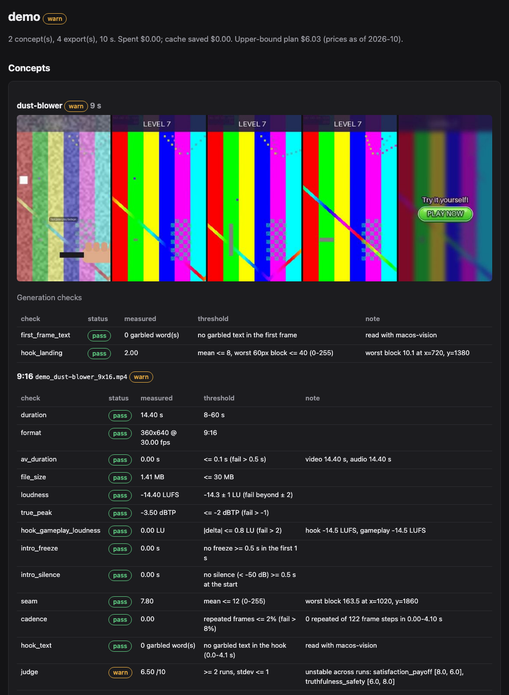
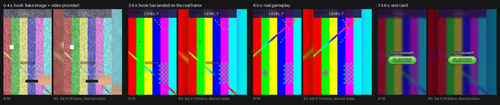
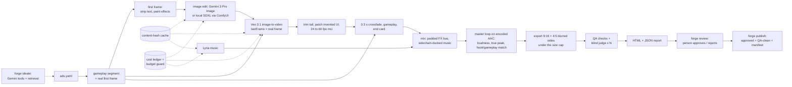

# creative-forge

[](https://github.com/emirhann-akca/creative-forge/actions/workflows/ci.yml)


[](LICENSE)

Spec-driven pipeline for mobile game video ads with an AI-generated hook and real gameplay. A YAML spec goes in. Mastered 9:16 and 4:5 videos come out, each with a QA report that records what was measured and the threshold it was judged against. A person approves what ships.

```
forge demo                                  # whole pipeline offline: fake providers, synthetic gameplay
forge ui                                    # the ads app: gallery, concepts, test cells, performance, approve / reject
forge ideate --game "..." --clips a.mp4     # draft concepts with a tool-calling LLM + lesson retrieval
forge plan   examples/ads.yaml              # cost estimate, spec lint and model licences, no calls
forge segments capture.mp4                  # suggest gameplay segment in/out points (PySceneDetect)
forge playable check game.html --network unity --network meta   # per-network rules + headless browser run
forge run    examples/ads.yaml --budget-usd 15
forge review out/puzzle-ads                 # approve / reject each export, with a note
forge publish out/puzzle-ads --to deliver/  # only approved files; refuses on failed QA unless overridden
forge perf import meta --account act_1 ...  # creative-level metrics from Meta / AppLovin / CSV into SQLite
forge perf report --write-lessons           # IPM, CTR, CPI, hook rate per creative and tag, with intervals
forge campaign create examples/campaign.yaml  # Meta / TikTok / Google Ads campaigns, all PAUSED; `activate` is apart
forge campaign demo                         # render -> approve -> paused campaigns -> simulated delivery, on a mock network
forge setup ffmpeg                          # pinned ffmpeg 9.0.2, SHA-256 verified, no admin rights
forge doctor                                # ffmpeg, OCR, folders, ComfyUI, credentials; exit 1 on a blocker
forge comfy check                           # a ComfyUI GPU worker: VRAM, missing Wan nodes and model files
```



*The HTML report from `forge demo`: contact sheet across the cut, generation checks, delivery checks with measured value and threshold, and a judge that warns when its two runs disagree.*

**What is in it**

- **The production recipe**: an image model edits a real gameplay frame, Veo 3.1 animates it with `lastFrame` set to the real first gameplay frame, a 0.3 s crossfade into the same level's gameplay, an end card, and a loudness-matched master. 9:16 and a 4:5 variant that never crops gameplay.
- **14 production defects, each prevented in the pipeline, measured by a check, or both**, with a test on synthetic media for each ([table](#qa-checks-and-the-defects-behind-them)).
- **Paid calls treated like money**: content-hash cache, the list price reserved against `--budget-usd` before each call, and a Veo job's operation name saved before polling so a crash resumes instead of paying twice.
- **A local open-model path**: SDXL through a local ComfyUI server for the hook image edit, with the workflow shipped as JSON.
- **Agentic ideation**: Gemini function calling over five local tools, with retrieval over the lesson library. It stops when its concepts pass the pipeline's own validation and lint.
- **Human in the loop**: `forge review` records decisions against file hashes; `forge publish` copies only approved, QA-clean exports with a manifest.
- **A performance loop**: deterministic creative IDs and ad names that round-trip, a tag taxonomy, `forge perf import` from Meta, AppLovin and CSV exports into SQLite, `forge perf report` with intervals (no winner on a small sample), and lessons that `forge ideate` retrieves.
- **An ads app for choosing, not just making**: `forge ui` / `forge app` (Turkish by default, English with `?lang=en`) shows every export as a playable card with IPM, CTR, CPI, spend and a confidence badge, a concept → variant board, approve / reject bound to the file hash, and **test cells**: 2–4 variants against a control, a kill / scale rule locked when the test starts, and sufficiency counted in installs.
- **Campaigns from approved creatives, paused by default**: `forge campaign` (and the UI's Kampanya page) turns a `forge publish` folder into app-install campaigns on Meta (Marketing API v27.0, Advantage+ app), TikTok (v1.3) and Google Ads (v26, App campaign), every object created PAUSED with an idempotency key, a dry-run preview of each request, a hash-chained audit log of every call, activation only by a typed phrase under per-campaign daily and total caps, refusal of placeholder store URLs, and kill / scale recommendations from the test cell's locked rule. Tested against a local mock of the three APIs only ([what ran where](#campaigns-created-paused-switched-on-by-a-typed-decision)).
- **More exports per paid generation**: a variant matrix (hooks × segments × end cards × languages × formats) that pays once per hook, and `forge segments` to cut gameplay with PySceneDetect.
- **Playables and licences**: `forge playable check|pack` against each network's published rules with a headless browser run, and a model licence registry that refuses non-commercial weights before any call.
- **A GPU worker on the LAN**: Wan 2.1 first-last-frame and Wan 2.2 TI2V-5B through ComfyUI, with health, VRAM and model checks, resume by prompt id and an explicit cloud fallback (mock-tested; not yet run on a GPU).
- **Runs on Windows 10/11, macOS (Apple Silicon) and Linux**: one-line installers that need no admin rights, a pinned ffmpeg, RapidOCR where Apple Vision is missing, and CI that installs the built wheel the way a user would on each OS, then runs the demo in a folder named `Çalışma Ş/İğ`.
- 439 tests (about 2 min on an M4 Mac, most of it the headless-browser playable runs and two full demo renders), run on Windows, macOS and Ubuntu with Python 3.11, 3.12 and 3.13; any text I/O that depends on the locale's encoding fails them. `forge demo` takes about 10 s.



*`forge demo` output, synthetic content: the fake hook, the hook landing on the real frame, real gameplay, end card. Each pair shows 9:16 and the 4:5 variant.*

## Why it exists

I used these scripts in October 2026 to produce my studio's UA video ads for *Acorn Mart: Goods Sorting*, our goods-sort puzzle game [live on Google Play](https://play.google.com/store/apps/details?id=com.emirhan.cartherounity). The final round was 7 ads, 25–30 s each, delivered in 9:16 and 4:5, mastered to about −14 LUFS with true peak at or below −2.6 dBTP. Gemini 3 Pro Image edited the frames, Veo 3.1 animated them and Lyria 3 Pro made the music.

The scripts worked, but every QA round found a defect a quick watch had missed. They were one-off, single-machine scripts. This repo turns them into a tool someone else can run: each defect became a requirement that the pipeline prevents, a check measures, or both.

## Design decisions

- **The AI shot has to end on real pixels.** I set Veo's `lastFrame` to the first frame of the gameplay segment *after* it has been cropped, scaled and retimed, so the hook lands on exactly what follows the cut. The cut is where a viewer notices an ad is fake; a 0.3 s crossfade covers the small remaining difference, and `hook_landing` and `seam` measure it.
- **The image model is asked for the smallest edit, and the code enforces the rest.** Gemini redrew the products when I asked it to cover the board in dust, so dust and mud are painted on the real frame in numpy and the model only adds the hand. With `hook.edit_region`, every pixel outside the box is copied back from the real frame after the edit. A prompt can only ask; the composite guarantees.
- **Loudness and true peak are measured after encoding.** ffmpeg's built-in AAC encoder pushed a limited master 6.7 dB over its ceiling while the pre-encode measurement looked fine. The master loop encodes every round and measures the file that ships. It uses a secant step, because behind a working limiter 1 dB of gain buys less than 1 dB of loudness.
- **The budget is reserved before a call, not checked after.** With concepts rendering in parallel, "spent < budget" lets two jobs both pass the check and overspend. Each call reserves its list price under a lock first; a call without a known price is refused while a budget is set.
- **A paid submit is never retried on an ambiguous error.** Only 429, 503 and connections that never reached the server are retried. A read timeout or a 500 may mean the Veo job exists and is billed, so the run stops and says so instead of submitting again. Once a submit is accepted, its operation name is saved before the first poll, so a crash or a polling timeout after that resumes the same job.
- **Fakes over mocks for media.** The fake providers make real files with ffmpeg: a 24 fps clip with audio that dissolves onto `lastFrame`. Tests and the demo therefore run the real interpolation, loudness loop and QA on real media. Mocks appear only at the HTTP boundary.
- **A check never passes silently.** Every result carries the measured value and the threshold. When a check cannot run (no OCR backend, no timeline), it reports `skip` with the reason.
- **A person approves bytes, not names.** A review decision stores the file's SHA-256, so a re-render voids it, and a failed check blocks publishing unless someone writes an override reason into the manifest.
- **The agent can only act through the pipeline's own validators.** `forge ideate`'s tools call the same `AdSpec`, `lint` and `estimate` code as `forge run`, the loop has a hard step cap, and anything a model cannot know (pixel boxes of text) is left as a TODO for a person. Retrieval is a JSON file of vectors searched with numpy: at 19 entries a vector database would add a moving part and no recall.

## Architecture



Providers sit behind small interfaces (`ImageEditProvider`, `VideoProvider`, `MusicProvider`, `JudgeProvider`). The Vertex AI implementations call REST directly with `google-auth` Application Default Credentials and `requests`. [docs/ARCHITECTURE.md](docs/ARCHITECTURE.md) has the module map, the timeline arithmetic and the master loop.

## Install

**macOS (Apple Silicon) and Linux (x86_64)**, in a terminal:

```sh
curl -LsSf https://raw.githubusercontent.com/emirhann-akca/creative-forge/main/install.sh | sh
```

**Windows 10/11 (x64)**, in PowerShell:

```powershell
powershell -ExecutionPolicy Bypass -c "irm https://raw.githubusercontent.com/emirhann-akca/creative-forge/main/install.ps1 | iex"
```

(In PowerShell 7 the same line works with `pwsh` in place of `powershell`.)

Each installer works inside your user profile and needs no admin rights and no git:

1. downloads [uv](https://github.com/astral-sh/uv) 0.13.7 and checks its SHA-256 against the value written in the script;
2. installs `creative-forge[ocr]` with `uv tool install` and Python 3.13, which uv downloads if you do not have it. It first tries the release wheel of the installer's version; when no such release exists (HTTP 404) it installs the source archive of the `main` branch (`https://github.com/emirhann-akca/creative-forge/archive/refs/heads/main.zip`), which uv builds locally with the package's own build backend. It prints which source it used. `forge` lands in `~/.local/bin` (Windows: `%USERPROFILE%\.local\bin`), and that folder is added to your PATH for new terminals;
3. runs `forge setup ffmpeg` and `forge doctor`;
4. adds a **Creative Forge** launcher: Start menu and Desktop shortcuts on Windows, `~/Applications/Creative Forge.app` on macOS (Launchpad and Spotlight find it), an applications-menu entry on Linux. `FORGE_NO_SHORTCUT=1` skips it; `forge app --install-shortcut` / `--uninstall-shortcut` add or remove it later.

**Open it like an app.** A double-click starts the review UI on `127.0.0.1` and a free port and opens it in a window of its own (Edge, Chrome, Brave or Chromium in app mode: no tabs, no address bar; the default browser otherwise). Runs live in the data folder's `runs` (the page's "Run the demo" button fills it); `forge app --root <folder>` switches folders and the icon remembers it. A second double-click opens a window on the running server instead of starting another; closing the last window stops the server about 20 seconds later (the pages tell it they are leaving), and the log is in the data folder's `app/logs/app.log`. `forge app --check` starts, loads the pages and stops; CI runs it from the installed launcher on Windows, macOS and Linux.

Open a new terminal afterwards. `-ExecutionPolicy Bypass` applies to that one PowerShell process only: Windows clients default to the `Restricted` policy, under which no script runs. To read a script before running it, open the same URL in a browser. `FORGE_SOURCE` (a wheel or a source archive), `FORGE_RELEASE_URL`, `FORGE_ARCHIVE_URL` and `FORGE_PYTHON` override the defaults.

When a release exists (`release.yml` builds and attaches everything from a `v*` tag), the installers attached to it pin that release:

```sh
curl -LsSf https://github.com/emirhann-akca/creative-forge/releases/latest/download/install.sh | sh
```

```powershell
powershell -ExecutionPolicy Bypass -c "irm https://github.com/emirhann-akca/creative-forge/releases/latest/download/install.ps1 | iex"
```

CI runs the two `main` one-liners above, read from this README, on Ubuntu, macOS, Windows PowerShell 5.1 and PowerShell 7 (pointed at the commit under test), plus jobs where the release wheel is missing and the archive fallback has to work.

From a clone, for development:

```sh
# macOS / Linux
python3 -m venv .venv && . .venv/bin/activate
pip install -e ".[dev,ocr,segments,playable]"
forge setup ffmpeg && forge doctor
```

```powershell
# Windows PowerShell: no activation needed (Activate.ps1 is blocked by the default policy)
py -3.13 -m venv .venv
.venv\Scripts\python -m pip install -e ".[dev,ocr,segments,playable]"
.venv\Scripts\forge setup ffmpeg
.venv\Scripts\forge doctor
```

## Quickstart (no keys, no cost)

```bash
forge demo            # writes out/demo/: 2 concepts x 2 formats + report.html
forge ui              # opens http://127.0.0.1:8765: overview, creatives gallery, concepts, tests, performance
forge app             # the same UI in its own window (what the desktop icon runs)
forge ideate --game "goods-sort puzzle" --clips out/demo/inputs/gameplay.mp4 --n 2   # scripted model, offline
pytest                # from a clone
```

The demo builds synthetic "gameplay" from ffmpeg's `testsrc2` and runs every stage with fake providers, including real 24 → 60 fps motion interpolation, the loudness loop, both exports, OCR and a two-run blind judge. The report shows $0 charged next to the list price the same calls would cost on Vertex AI.

## ffmpeg, doctor and the local UI

**`forge setup ffmpeg`** keeps a usable ffmpeg if one resolves, otherwise downloads FFmpeg 9.0.2 into the user data folder (`%LOCALAPPDATA%\creative-forge`, `~/Library/Application Support/creative-forge`, `~/.local/share/creative-forge`). `--force` downloads even when one resolves. Each archive is pinned by URL, size and SHA-256; a mismatch deletes the download and installs nothing. The binaries are then probed for libx264, an AAC encoder, `minterpolate`, `ebur128`, `loudnorm`, `freezedetect`, `silencedetect` and a few more filters the pipeline uses; a build that lacks any is refused with the list.

| Platform | Build | SHA-256 checked against |
|---|---|---|
| Windows x64 | Gyan Doshi "essentials", GyanD/codexffmpeg 9.0.2 release (the publisher winget's `Gyan.FFmpeg` installs from) | the checksum gyan.dev publishes |
| macOS arm64 | Martin Riedl, signed with his Developer ID | the `.sha256` file next to each archive |
| Linux x64 | Martin Riedl | the `.sha256` file next to each archive |

Which ffmpeg runs: `CREATIVE_FORGE_FFMPEG_DIR` (a folder holding ffmpeg and ffprobe; if it is wrong that is an error, not a fallback), then the managed build, then `PATH`.

**`forge doctor`** reports ffmpeg and ffprobe (path, where they came from, version, missing features, which AAC encoders actually open), the OCR backend `--ocr auto` will use, Python, the data and cache folders and whether they and the working folder are writable, ComfyUI's `/system_stats` when `CREATIVE_FORGE_COMFYUI_URL` or `--comfyui URL` is given, and whether Application Default Credentials exist (only the file's `type` is shown, never its contents). It exits 1 on a blocking problem; `--json` prints the same as JSON.

**`forge ui`** serves the ads app on `127.0.0.1` (port 8765, or a free one); `forge app` opens the same pages in a window of their own. It reads the runs under `--root` (default `out`) and the performance store, and writes only through the functions the CLI uses. Pages are in Turkish by default and in English with `?lang=en` (remembered in a cookie); one dictionary holds every word, in `ui/i18n.py`.

| Page | What it shows |
|---|---|
| Overview | what needs a decision today (QA failures, exports waiting for review, approvals voided by a re-render, tests that reached their threshold), counts, recent runs, and the next setup step when something is missing |
| Creatives | every export as a card: a poster frame (one ffmpeg frame, cached by size and mtime) that plays inline, IPM / CTR / CPI / spend from the store when its creative ID matches, the `forge perf report` verdict as a confidence badge ("örneklem yetersiz" below the threshold), QA and review status, hook and mechanic tags; filters by review state, QA, tag, format, concept and run. The detail view has the QA checks with measured value and threshold, the lineage (spec → concept → variant → format), performance per network and approve / reject with a note |
| Concepts | each concept's hypothesis (`hypothesis:` in the spec), hook types, mechanics, emotions and formats, with its renders underneath |
| Tests | test cells; see [Test cells](#test-cells-a-control-a-locked-rule-and-installs) |
| Performance | the `forge perf report` tables per network (per creative and per tag, any metric, any minimum) and the last import per network |
| Playables | `forge playable check --json` results saved under `<root>/playables/` and each network's rules with their sources |
| Campaigns | a placeholder: no network write call exists in the app; the read-only campaign tree comes with paid UA, writes and automation last and behind gates |
| Settings | which network credentials are present (by variable name, never the value), a CSV upload that runs the same import as `forge perf import csv`, the data folders, `forge doctor`, the demo |

Approve and reject call the same `review.decide` as `forge review`, so a decision is tied to the file's SHA-256 and `forge publish` gates exactly as before; a re-render shows the approval as void. Publishing stays on the command line. Requests with a non-loopback `Host` header are refused, and every change needs a per-process token that only the served pages carry. `--host 0.0.0.0` exposes it to your network, and anyone who can open the page can then approve exports. FastAPI, Jinja2, [htmx](https://htmx.org) 2.0.11 (vendored with its 0BSD license) and `ui.css` / `ui.js`, the design system shared byte for byte with studio-pulse; no Node build and no request leaves the machine.

## Windows notes

- The tool's own files live in `%LOCALAPPDATA%\creative-forge` (uv, ffmpeg) and `%LOCALAPPDATA%\creative-forge\Cache` (nothing roams). `CREATIVE_FORGE_HOME` moves both.
- Keep run folders short and outside OneDrive-synced Desktop/Documents: Windows paths stop at 260 characters unless long paths are enabled, the generation cache adds about 90, and OneDrive locks files while it uploads them.
- Renames that a virus scanner or the search indexer briefly blocks are retried for up to about 3.5 s.
- AAC: `aac_mf` (Media Foundation) is preferred over ffmpeg's built-in `aac`. Windows "N" editions without the Media Feature Pack lack Media Foundation; the encoder is tried before use and the pipeline falls back to `aac`. Either way the master loop measures true peak on the encoded file.
- OCR uses RapidOCR (PP-OCR models on onnxruntime, shipped in the wheel; no download at run time). macOS keeps Apple Vision as its first choice; `--ocr rapidocr` selects RapidOCR there too.
- Output is UTF-8 when it goes to a pipe or a file, so a path with "Ş" cannot crash a command; Windows PowerShell may still display such characters wrongly in redirected output.

## Real run (Vertex AI)

```bash
gcloud auth application-default login
export CREATIVE_FORGE_PROJECT=<your-project-id>   # never stored in the repo
# optional: CREATIVE_FORGE_VIDEO_LOCATION (default us-central1), CREATIVE_FORGE_GENAI_LOCATION (default global)

forge plan examples/ads.yaml                 # upper-bound cost, lint findings
forge run examples/ads.yaml --dry-run        # + input files, ffmpeg, project variable, ComfyUI if used
forge run examples/ads.yaml --budget-usd 15
```

Model IDs live in the spec (`models:`) and prices in [`creative_forge/data/pricing.yaml`](creative_forge/data/pricing.yaml) (`as_of: 2026-10`). Check both against Google Cloud before a paid run, and override prices with `--pricing pricing.local.yaml`. The judge has no recorded price, so under a budget it is refused until you add one.

## Model licence guard

Several models people reach for are not licensed for paid ads: FLUX.1 Kontext [dev] and FLUX.2 [dev] exclude "revenue-generating activity", MusicGen and F5-TTS weights are CC-BY-NC, XTTS-v2 is under the Coqui Public Model License, the Turkish Piper voice's dataset is CC BY-NC-SA, rembg's default model (BRIA RMBG-2.0) needs a paid agreement, and HunyuanVideo's licence does not apply in the EU, the UK or South Korea. [`data/model_licenses.yaml`](creative_forge/data/model_licenses.yaml) lists every model the tool can call (Vertex AI models, Wan 2.1 FLF2V/I2V, Wan 2.2 TI2V-5B/A14B, Qwen-Image-Edit, SDXL, LTX, FLUX, HunyuanVideo, CogVideoX, MusicGen, ACE-Step, XTTS-v2, F5-TTS, Piper, Kokoro, Chatterbox, rembg models, RapidOCR, faster-whisper) with its code licence, weights licence, commercial status, conditions, source URL and the date the source was read.

`forge plan` and `forge run` resolve every model the spec would call (image edit, video, music, judge; ComfyUI file names included) and print a licence table:

| Verdict | When | Effect |
|---|---|---|
| `refuse` | non-commercial weights; a territory clause and `targets.regions` is empty or includes an excluded territory; a revenue cap at or below `targets.annual_revenue_usd` | `forge plan` exits 1, `forge run` exits 4 before building a provider, both naming the licence and its source |
| `warn` | a conditional licence (LTX's $10M revenue cap, CogVideoX registration, Hunyuan with regions outside its exclusions), or a model the registry does not know | printed, not blocking |
| `ok` / `service` | open weights that allow it; a hosted API whose service terms apply (not reviewed here) | printed |

```yaml
targets:
  regions: [TR, US]               # ISO codes or EU / EEA / UK; empty means "may serve anywhere"
  annual_revenue_usd: 250000      # checked against revenue caps; undeclared caps warn
```

A refusal can only be overridden per model and with a reason: `forge run spec.yaml --license-override flux2-dev.safetensors="licensed from BFL, contract 42"`. The reason, the refused licence and its source go into `cost_ledger.json` (`license_overrides`) and `report.json`. `forge licenses` lists the registry; `forge licenses <model>` looks one up. The registry records what each licence said when it was read; it is not legal advice, and licences change.

## Local SDXL through ComfyUI

```yaml
image_provider: comfyui            # the other steps still use `providers`
comfyui: {checkpoint: sd_xl_base_1.0.safetensors, steps: 28, seed: 7}
concepts:
  - hook: {image_prompt: "...", edit_region: [600, 1100, 1080, 1700]}   # inpaint mask; outside is restored
```

The provider uploads the frame (resized to a ~1 MP SDXL canvas) and the mask to ComfyUI's temp folder, queues [`sdxl_inpaint.json`](creative_forge/data/comfyui/sdxl_inpaint.json) or [`sdxl_img2img.json`](creative_forge/data/comfyui/sdxl_img2img.json) with `POST /prompt`, polls `/history/{id}` and fetches the `PreviewImage` result with `/view`, so nothing lands in ComfyUI's `input/` or `output/`. Set `CREATIVE_FORGE_COMFYUI_URL` (default `http://127.0.0.1:8188`); `--dry-run` checks that the server answers and has the checkpoint. Local calls are free and have no list price.

Verified on 10 Nov 2026 on an Apple Silicon Mac (M4, 24 GB) with `sd_xl_base_1.0.safetensors`: a masked edit of a 360×640 demo frame on a 768×1344 canvas, 28 steps, returned an image in 176 s from a cold start (167 s for a second run). The plumbing works; the base checkpoint did not draw a recognizable hand on the abstract test frame, so real edits want an inpainting checkpoint.

## Hook video on a ComfyUI GPU worker (Wan 2.1 FLF2V / Wan 2.2 TI2V-5B)

**Not yet run on a GPU.** Everything below is tested against a mocked ComfyUI server (a real `http.server` that answers `/system_stats`, `/object_info`, `/models`, `/upload/image`, `/prompt`, `/history`, `/queue` and `/view` and renders a clip from the uploaded frames); the first real run will be on the studio's Windows NVIDIA desktop.

```yaml
video_provider: comfyui              # the hook video goes to the worker; image edit, music and judge keep `providers`
comfyui_video:
  workflow: wan21_flf2v              # first frame = edited hook frame, last frame = the real gameplay frame
  # workflow: wan22_ti2v_5b          # 8 GB cards: image-to-video, no last frame (lands via crossfade + patches)
  diffusion_model: wan2.1_flf2v_720p_14B_fp8_e4m3fn.safetensors   # file names are parameters
  steps: 20
  cloud_fallback: false              # true: use models.video (Veo, paid, budget-guarded) if the worker is not ready
```

- **The same landing recipe as Veo.** Wan 2.1 has an official first-last-frame model, so [`wan21_flf2v.json`](creative_forge/data/comfyui/wan21_flf2v.json) (`WanFirstLastFrameToVideo`) takes the edited hook frame as its first frame and the real gameplay frame as its last. [`wan22_ti2v_5b.json`](creative_forge/data/comfyui/wan22_ti2v_5b.json) (`Wan22ImageToVideoLatent`) has no last-frame input. Both end in ComfyUI's native `CreateVideo` + `SaveVideo`; frame counts are 4k + 1 at the workflow's fps (Wan 2.1: 16, Wan 2.2: 24). The clip then goes through the same trim → patches → 60 fps mci → crossfade path, and `hook_landing`, `seam` and `cadence` judge it as they judge Veo.
- **Routing, never silent.** Before the run, the worker must answer `/system_stats`, list every node class and input name the workflow uses in `/object_info`, and have every model file in `/models/<folder>`. If not, the run stops with the list, unless `cloud_fallback: true`, in which case the cloud model runs with the budget reserved first. `cost_ledger.json` records which one ran and why (`routing`).
- **Resume by `prompt_id`.** The id is saved the moment the worker accepts the job (the same pending file as Veo's operation name). A rerun after a crash or a timeout waits for that prompt (reporting its queue position) instead of queueing it again; if the worker restarted and lost it, it is queued again, which costs time, not money. Ctrl-C sends `/interrupt`.
- **Worker on the LAN.** `CREATIVE_FORGE_COMFYUI_URL=http://192.168.1.20:8188`; connect and read timeouts; uploads go to ComfyUI's temp folder. ComfyUI itself has **no authentication** (its routes, `/userdata` write and delete included, are open to whoever reaches the port), so if you put a reverse proxy in front of it, `CREATIVE_FORGE_COMFYUI_TOKEN` is sent as `Authorization: Bearer …` (`CREATIVE_FORGE_COMFYUI_AUTH_HEADER` changes the header) and never printed.
- **`forge comfy check`** (or `--spec spec.yaml`, or `forge run --dry-run`) prints the worker's ComfyUI version, GPU and VRAM with what the sources say fits that VRAM, missing node classes, inputs a node does not declare on that ComfyUI version, and missing model files with their Hugging Face download URL. `forge doctor` shows the VRAM too.
- Local calls are free and have no list price; the cache key holds the workflow's hash, the model files, size, fps, sampler settings and seed.

**What fits which card** (only figures stated by official sources; the rest must be measured):

| VRAM | Workflow | Source |
|---|---|---|
| 8 GB | `wan22_ti2v_5b` | ComfyUI docs: TI2V-5B "should fit well on 8GB vram with the ComfyUI native offloading" (docs.comfy.org/tutorials/video/wan/wan2_2) |
| 12–16 GB | `wan22_ti2v_5b`; `wan21_flf2v` with the fp8 file is **unverified** at this size | — |
| 24 GB | `wan21_flf2v` (fp8, or fp16 with ComfyUI's offloading) | Wan's own CLI: the 14B models need 80 GB without offloading, or `--offload_model --convert_model_dtype --t5_cpu`; the Wan 2.2 README states 24 GB (RTX 4090) for TI2V-5B in that CLI |

Wan 2.1 FLF2V is 720P only and was trained mainly on Chinese text; its README recommends Chinese prompts. The sampler defaults (FLF2V: 20 steps, cfg 5; TI2V-5B: 30 steps, cfg 5; shift 8, `uni_pc`/`simple`) are starting points, not measured values.

### Setting up the Windows NVIDIA desktop as the worker

1. Install **ComfyUI portable for NVIDIA**: download `ComfyUI_windows_portable_nvidia.7z` from the latest release at https://github.com/Comfy-Org/ComfyUI/releases, extract it with 7-Zip to a short path such as `C:\ComfyUI`, and run `update\update_comfyui.bat` once (the Wan nodes are native in current releases). ComfyUI is GPL-3.0; it runs as a separate program and does not cover the media it generates.
2. Put the model files (Apache-2.0: [Wan-AI/Wan2.1-FLF2V-14B-720P](https://huggingface.co/Wan-AI/Wan2.1-FLF2V-14B-720P), [Wan-AI/Wan2.2-TI2V-5B](https://huggingface.co/Wan-AI/Wan2.2-TI2V-5B); the ComfyUI-ready files come from Comfy-Org's repackaged repositories, also tagged apache-2.0) under `C:\ComfyUI\ComfyUI\models\`:

   | Folder | File | From |
   |---|---|---|
   | `diffusion_models` | `wan2.1_flf2v_720p_14B_fp16.safetensors` or `wan2.1_flf2v_720p_14B_fp8_e4m3fn.safetensors` | [Comfy-Org/Wan_2.1_ComfyUI_repackaged](https://huggingface.co/Comfy-Org/Wan_2.1_ComfyUI_repackaged/tree/main/split_files/diffusion_models) |
   | `text_encoders` | `umt5_xxl_fp8_e4m3fn_scaled.safetensors` | [same repo, `split_files/text_encoders`](https://huggingface.co/Comfy-Org/Wan_2.1_ComfyUI_repackaged/tree/main/split_files/text_encoders) |
   | `vae` | `wan_2.1_vae.safetensors` | [same repo, `split_files/vae`](https://huggingface.co/Comfy-Org/Wan_2.1_ComfyUI_repackaged/tree/main/split_files/vae) |
   | `clip_vision` | `clip_vision_h.safetensors` | [same repo, `split_files/clip_vision`](https://huggingface.co/Comfy-Org/Wan_2.1_ComfyUI_repackaged/tree/main/split_files/clip_vision) |
   | `diffusion_models` | `wan2.2_ti2v_5B_fp16.safetensors` (8 GB tier) | [Comfy-Org/Wan_2.2_ComfyUI_Repackaged](https://huggingface.co/Comfy-Org/Wan_2.2_ComfyUI_Repackaged/tree/main/split_files/diffusion_models) |
   | `vae` | `wan2.2_vae.safetensors` (8 GB tier) | [same repo, `split_files/vae`](https://huggingface.co/Comfy-Org/Wan_2.2_ComfyUI_Repackaged/tree/main/split_files/vae) |

3. Start it on the LAN address only: in `run_nvidia_gpu.bat` add `--listen 192.168.1.20 --port 8188` (the box's own LAN IP, not `0.0.0.0`). The research also notes ComfyUI's `--offline` option, which keeps paid partner API nodes from running; add it if `python_embeded\python.exe ComfyUI\main.py --help` lists it.
4. Allow only the orchestrator through Windows Firewall (PowerShell as administrator; keep the network profile Private):
   ```powershell
   New-NetFirewallRule -DisplayName "ComfyUI from the orchestrator" -Direction Inbound -Protocol TCP -LocalPort 8188 -RemoteAddress 192.168.1.10 -Action Allow -Profile Private
   ```
   Alternatives: keep ComfyUI on `127.0.0.1` and reach it through an SSH tunnel (`ssh -N -L 8188:127.0.0.1:8188 you@gpu-box` with Windows' OpenSSH server) or a private overlay network, or a reverse proxy with a token (`CREATIVE_FORGE_COMFYUI_TOKEN`).
5. On the orchestrator (the Mac, or the same Windows machine): `export CREATIVE_FORGE_COMFYUI_URL=http://192.168.1.20:8188` (PowerShell: `$env:CREATIVE_FORGE_COMFYUI_URL = "http://192.168.1.20:8188"`), then `forge comfy check` until it says `ready`, then `forge run spec.yaml --dry-run`.
6. The first real run is the acceptance test: one concept with `video_provider: comfyui` should pass `hook_landing` and `seam`; note the seconds the ledger records for the video step and the peak VRAM from `nvidia-smi`.

## Human review gate

```bash
forge review out/puzzle-ads --reviewer ayse                  # interactive: a / r / s and a note per export
forge review out/puzzle-ads --approve cf1.puzzle-ads.dust-blower.main.main.main.9x16.en.6453fdb366.mp4 --note "hook reads well"
forge publish out/puzzle-ads --to deliver/                   # refuses if an approved export failed QA
forge publish out/puzzle-ads --to deliver/ --override "network re-encodes audio anyway"
```

Decisions go to `review.json` next to the run, each with reviewer, time, QA status and the file's SHA-256. Publishing copies nothing when nothing is approved, when an approved file changed after review, or when an approved export (or its concept's generation checks) has a failed check and no override reason. `manifest.json` lists what was published, by whose approval, what was overridden and why, and what was left out.

## Creative IDs, ad names and tags

Every export is one creative: (spec, concept, hook, gameplay segment, end card, format, language). Its ID is a hash of those seven names, and its ad name carries all of them plus the ID:

```
cf1.<spec>.<concept>.<hook>.<segment>.<end_card>.<format>.<language>.<creative_id>
cf1.puzzle-ads.dust-blower.main.main.main.9x16.en.6453fdb366
```

- **Deterministic.** The ID depends only on the names in the spec, so re-rendering a variant keeps its ID. A concept without variants uses `main` for hook, segment and end card; `language:` (default `en`) sets the language.
- **Round-trips.** `naming.parse(name)` returns the seven names and refuses a name whose ID does not match them, so a hand-edited name is not booked against the wrong creative. `naming.find(text)` finds the name inside a longer one (`"… - Copy (2)"`), which is how `forge perf import` maps network ad names back.
- **The file name is the ad name** (`<ad name>.mp4`), so whatever the uploader keeps maps back.

**Tags** come from a controlled vocabulary, [`data/tag_taxonomy.yaml`](creative_forge/data/tag_taxonomy.yaml) (or your own with `taxonomy: my_tags.yaml`): `hook_type`, `mechanic_shown` and `emotion` are set per concept (and per hook variant); `format`, `length_bucket` and `ai_generated` are derived per export. An unknown dimension or value, a list for a single-value dimension, or a hand-set derived tag fails lint: `forge plan` exits 1 and `forge run` exits 2 before any call. A concept without tags only warns, because `forge perf report` cannot group it.

```yaml
concepts:
  - id: dust-blower
    tags: {hook_type: satisfying-clean, mechanic_shown: [goods-sort], emotion: [satisfaction]}
```

Each export's `.forge.json` sidecar holds `creative_id`, `ad_name`, the seven `ids`, the `tags` and the `models` that made it with their licences; `report.json` carries the ID, name and tags, and `forge publish` copies all of it into `manifest.json`. `forge ideate` drafts fill `hook_type` and `emotion` from the taxonomy's values and leave `mechanic_shown` to a person.

## Variant matrix: many exports, few paid generations

```yaml
concepts:
  - id: dust-blower
    gameplay: {path: footage/level_71.mp4, in_s: 7.6, out_s: 10.6}   # the landing segment: every hook lands here
    hook: {image_prompt: "...", video_prompt: "...", cut_s: 5.45}
    end_card: {headline: {en: "Fill every order!", tr: "Her siparişi yetiştir!"}, button: {en: PLAY NOW, tr: OYNA}}
    variants:
      hooks:                                    # merged over `hook`; each may carry its own tags
        - {id: blower}
        - {id: washer, video_prompt: "...", tags: {hook_type: real-hand}}
        - {id: oops, image_prompt: "...", tags: {hook_type: fail-state}}
      segments:                                 # more real gameplay after the landing segment (hard cut)
        - {id: lvl7, in_s: 12, out_s: 20}       # merged over `gameplay`: same path and crop
        - {id: lvl21, path: footage/level_21.mp4, in_s: 3, out_s: 11}
      end_cards: [{id: fill}, {id: try, headline: {en: "Try it yourself!", tr: "Kendin dene!"}}]
      languages: [en, tr]
```

Every hook lands on the first frame of the concept's `gameplay` (the landing segment), so a hook's image edit and video generation do not depend on what follows: one generation serves every segment, end card, language and format, inside a run (a per-key memo) and across runs (the content-hash cache). Segments are joined to the landing segment with a hard cut; the AI-to-real seam stays where it was measured. Each (hook, segment, end card, language) is one render, assembled, mixed, mastered and checked on its own, then exported in every format, and each export gets its own creative ID and ad name. Music is one track per concept, generated for its longest render.

`forge plan` counts both sides: 3 hooks × 4 segments × 2 end cards × 2 formats is `48 export(s) from 24 render(s); … 3 hook video(s)` at the price of three Veo clips. A test runs a 2 × 2 × 2 matrix with fake providers and checks that each hook was generated once and that adding a third language generated nothing new. Hook, segment and end-card ids are lowercase `a-z0-9-`; a typo in a variant fails at load, lint runs on every hook (`c1/oops: [tail-drift] …`), and a localized text missing a language is an error.

**`forge segments capture.mp4`** suggests segments from a gameplay recording with [PySceneDetect](https://github.com/Breakthrough/PySceneDetect) (BSD-3-Clause; `pip install "creative-forge[segments]"`): it finds the hard cuts (`--detector content` or `adaptive`), trims `--margin` (0.2 s) at both ends of every scene, keeps scenes of at least `--min-len` seconds (capped at `--max-len`) and prints a `variants.segments` block to paste into a spec (`--json` for the raw cut list). On a synthetic capture with cuts at frames 60, 105 and 165, both detectors find all three within one frame.

## Performance import

```bash
export CREATIVE_FORGE_META_TOKEN=...          # ads_read; from the environment only, never a file or a flag
forge perf import meta --account act_123 --since 2026-10-01 --until 2026-10-31 [--by-country]
export CREATIVE_FORGE_APPLOVIN_KEY=...        # AppLovin Report Key
forge perf import applovin --since 2026-10-20 --until 2026-10-31 [--assets]
forge perf import csv tiktok_export.csv --network tiktok      # also unity, google, mintegral, ... exports
forge perf register deliver/manifest.json                      # creative IDs + tags of what was published
```

Rows go into one SQLite file (`perf.sqlite` in the user data folder, `--db` to move it): one row per network ad unit per day (Meta ad, AppLovin creative set; an AppLovin asset per report window), keyed on (network, account, level, date, ad, country). Every write is an upsert, so re-importing a range replaces rows instead of adding them. Each row's network ad name is searched for a creative-forge ad name (`naming.find`), which sets its `creative_id`; names that are not ours are kept and listed after the import as unmatched.

| Source | Request | What is stored |
|---|---|---|
| Meta | `GET /v27.0/act_<id>/insights`, `level=ad`, `time_increment=1`, cursor pagination | impressions, clicks, spend; installs = the first of `mobile_app_install` / `app_install` / `omni_app_install` (they overlap, so never summed); `video_view`, which Meta labels "3-Second Video Views" (the hook-rate numerator); `video_p25…p100_watched_actions`; thruplay |
| AppLovin | `GET r.applovin.com/report`, `report_type=advertiser`, columns incl. `creative_set_id`, `conversions`; `limit`/`offset` pagination; last 45 days only | impressions, clicks, cost, installs per creative set per day |
| AppLovin assets | `GET r.applovin.com/assetAnalyticsReport` (`--assets`) | impressions, clicks, cost per asset over the window; no installs exist at this level, and each asset joins its creative set's creative ID |
| CSV | any export with a date, an ad name and impressions; headers matched case-insensitively, `--column FIELD=HEADER` for the rest; UTF-8/UTF-16, `,` `;` or tab | the same metrics; TikTok's 2- and 6-second views go into their own columns and are never compared with Meta's 3-second views |

Tokens: Meta's goes in an `Authorization: Bearer` header, and the `access_token` Meta puts into its `paging.next` links is removed before the next page is fetched. AppLovin accepts its key only as a URL parameter, and `requests` writes the URL into its exception messages, so transport errors are re-raised with only the exception class and host, outside the `except` block (no chained exception holds the URL), and every log line passes through a redactor. Tests check that neither secret reaches a log line, an exception chain, the terminal or the SQLite file. Retries cover HTTP 429/5xx, Meta's throttling codes (4, 17, 32, 613, 80000–80014) and `Retry-After`; when Meta's `x-fb-ads-insights-throttle` header reports 75 % of a quota used, the next page waits.

**Not run against the live APIs**: no tokens were available. The clients follow the documentation cited in the module docstrings (read on 11 Nov 2026) and are tested against fixtures shaped like those documents (`tests/fixtures/perf/`); AppLovin's pages do not document the JSON envelope, so both `{"results": [...]}` and a bare list are accepted.

## `forge perf report`: winners only with enough data

```bash
forge perf report --network meta --metric ipm --min-impressions 10000 --write-lessons
#   out/perf_report.html + .json; `forge ui` has the same tables under "Performance"
```

Per network (audiences and even metric definitions differ, so creatives are never compared across networks), per creative and per tag value:

| Column | Definition |
|---|---|
| IPM | installs / impressions × 1000 |
| CTR | clicks / impressions |
| CPI | spend / installs |
| hook rate | 3-second views / impressions. Meta labels `video_view` "3-Second Video Views"; dividing by impressions is an industry convention, not a Meta definition |
| hook rate (2 s) | TikTok's 2-second views / impressions, a separate column |
| completion | 100 % views / impressions |

A rate's denominator counts only impressions from rows that report its numerator (AppLovin reports no 3-second views, so it does not dilute Meta's hook rate). AppLovin asset rows are left out of the totals because their creative set already counts those impressions.

**Verdicts.** Each creative is compared with the rest of its network, each tag value with the other values of the same dimension (a creative tagged `emotion: [calm, humor]` counts in both groups). A row is a `winner` or `loser` only when both sides have at least `--min-impressions` (default 10,000) and their 95 % Wilson intervals do not overlap; otherwise it is `insufficient data` or `no clear difference`, whatever the point estimate. The table also gives P(better than the rest) from Beta posteriors with uniform priors (fixed-seed Monte Carlo, so reports reproduce). In the test fixture the creative with the highest IPM (30 on 600 impressions) is reported as `insufficient data`.

**Lessons.** `--write-lessons` turns every tag value with a verdict into a lesson in `<data dir>/library/perf_lessons.yaml`: network, dates, metric with its interval, sample sizes, the comparison group and P(better). `forge ideate` loads that file next to the bundled library, so `search_creative_library` returns it; a test checks that "which hook type wins on installs" retrieves the fixture's winning `hook_type=fail-state` lesson first. A new report replaces the lessons of the same network and metric.

**Market trends.** [studio-pulse](https://github.com/emirhann-akca/studio-pulse)'s market radar scans public store charts daily and writes `<data dir>/library/market_trends.yaml` (schema `studio-pulse/market_trends/v1`: `lessons:` entries with `id`, `title`, `text`, the mechanic as a `mechanic_shown` value, themes, twists, suggested hooks and evidence ids; `CREATIVE_FORGE_MARKET_TRENDS` points elsewhere). `forge ideate` loads them as kind `market_trend`, so `search_creative_library` can answer "which mechanic is rising" next to the production and performance lessons. Every number in a trend's text carries its label ([observed], [store-reported]); hooks are marked as a suggestion. The `mechanic_shown` vocabulary has `color-sort`, `screw-pin` and `jam` for the subgenres the radar tracks.

## Test cells: a control, a locked rule and installs

`forge perf report` compares a creative with the rest of its network. A test cell compares 2–4 variants with one **control** creative on one network, under a rule written **before** the test starts:

| Field | Default | Meaning |
|---|---|---|
| metric | IPM | also CTR or hook rate; the same definitions as `forge perf report` |
| scale lift | +20 % | scale a variant at least this much better than the control … |
| kill drop | 20 % | … kill one at least this much worse … |
| confidence | 95 % | … when P(variant beats control) from the Beta posteriors is at least this (at most 1 − this to kill) |
| first screen | 50 installs per arm | only a variant whose 95 % Wilson interval lies wholly below the control's is dropped here |
| decision | 200 installs per arm | a 20–30 % IPM difference needs roughly 200–430; below this the page says "no decision yet: N more installs" |

Cells live in the performance store (`test_cells` in `perf.sqlite`) and read `perf_rows` of their network from their first day on. Starting a cell stores the SHA-256 of its rule and refuses any later change to it; a started cell cannot be deleted, and a rule edited behind the app's back is reported as tampered. A draft counts no data. The logic is in [`perf/cells.py`](creative_forge/perf/cells.py) and reuses `perf.stats` and the report's aggregation.

## Campaigns: created paused, switched on by a typed decision

```bash
forge campaign plan examples/campaign.yaml        # dry run: every object and request body; nothing is sent
#   (the shipped example is refused until its store_url, id=DOLDUR, is your published listing)
forge campaign create examples/campaign.yaml      # Meta, TikTok, Google Ads: everything PAUSED; re-runs create nothing
forge campaign status                             # caps, schedule, last sync, the activation command
forge campaign activate <plan>:meta --confirm "YAYINA AL 20.00 USD"   # the one step that can spend
forge campaign sync                               # status, spend, per-creative delivery, kill / scale recommendations
forge campaign pause <plan>:meta                  # always allowed
forge campaign demo                               # the whole loop offline on the mock network (about 15 s)
forge campaign audit --tail 5                     # verify the hash chain of the audit log
```

`forge ui` has the same under **Kampanya**: the dry-run preview with every request body, one primary button "Kampanyayı hazırla (duraklatılmış)", a "Yayına al" form per campaign that shows the daily budget, total cap and last day and needs the typed phrase, a status table synced from the networks with the recommendations, and a button that runs the demo. A config is a YAML file in `<root>/campaigns/`; the page writes a starter one (mock mode) from a store URL, a budget and a `forge publish` folder.

**Safety rules, each enforced in code and covered by a test**

| Rule | How |
|---|---|
| Everything is created paused | Meta `status=PAUSED`, TikTok `operation_status=DISABLE`, Google `status=PAUSED` (a new Google campaign defaults to ENABLED) on campaign, ad set / ad group and ad. After the last create the campaign is read back; one that is not paused is paused at once and the run fails. |
| Activation is separate and typed | `YAYINA AL <daily> <currency>` (or `ACTIVATE …`) must be typed; the daily budget and total cap are checked against `limits` again (the config's and the ones stored at create, whichever is lower); the network's budget, currency and spend are read back, and a budget changed outside forge refuses activation. Ads and ad sets are switched on first, the campaign last. |
| Caps reach the network | `limits.max_daily` / `max_total` are required. The schedule is `floor(total_cap / daily)` days and every network gets the end date; Meta also gets `spend_cap` (when the cap is at least Meta's ~100 USD minimum) and TikTok a `BUDGET_MODE_TOTAL` campaign budget. Google App campaigns have no total budget, so there the end date and `sync` hold it. |
| No placeholder store URL | `https` on `play.google.com/store/apps/details?id=<package>` or `apps.apple.com/…/id<digits>`, no DOLDUR / TODO / TBD / FIXME / example / placeholder / xxx, and the platform must match. `plan --verify-store` also fetches the public listing. |
| Only reviewed, QA-clean files | The source is a `forge publish` folder; each export is re-checked: parsable ad name, SHA-256 unchanged since approval, QA `pass`/`warn`, no failed check, not published with `--override`, a reviewer recorded. Excluded files are listed with the reason. |
| Retries never double-create | Each object has a deterministic key (plan id + network + object) in its name as `[cf:<10 hex>]` and in a local journal (`campaigns.sqlite`). Only 429 / throttling and connections never established are retried; a read timeout, dropped connection or 5xx on a write stops the run with the object marked unknown, and the next run looks it up by key before creating anything. TikTok also gets the key as `request_id`. |
| Exact preview | `plan` / the page list every object, its request body and whether it will be created, already exists, changed (shown, never updated) or will be looked up. |
| Audit log | `audit.jsonl`: every API call (method, URL without secrets, request body, status, trimmed answer, time) and every decision, append-only, each record carrying the previous record's SHA-256; `forge campaign audit` names the first edited, deleted or reordered line. Tokens are redacted and secret-named keys are scrubbed. |
| Recommendations, not actions | `sync` imports per-creative delivery into the performance store and judges the campaign's test cell (`perf/cells.py`, rule locked at activation): kill → "pause the ad", scale → "raise the daily budget by hand to X" (at most +20 %, never above `limits.max_daily`). With `automation.auto_pause: true` a killed ad and a campaign at its cap are paused automatically; scaling is never automatic. On Google one video of an App ad cannot be paused alone, so it stays a recommendation. |
| Live needs an explicit switch | Creating or activating on a network in `mode: live` is refused unless `--live` is passed (CLI) or the live box is ticked (UI); reading, syncing and pausing need no switch. Credentials come from environment variables only, never the YAML. A re-run of `create` never touches a campaign it recorded before (an activated one stays active). |

**Networks** (API versions and pages read on 14 Nov 2026; [`campaigns/versions.py`](creative_forge/campaigns/versions.py) keeps the URLs)

| Network | API | What `create` makes | Sandbox |
|---|---|---|---|
| Meta | Marketing API **v27.0** (released 4 Nov 2026) | `OUTCOME_APP_PROMOTION` campaign with the budget on the campaign + ad set with `promoted_object` and Advantage+ audience, no placements (so Advantage+ placements): the three levers that make Meta report `ADVANTAGE_PLUS_APP` since `smart_promotion_type` was retired for creation in v25.0; per creative `advideos` upload, the video's thumbnail, an `INSTALL_MOBILE_APP` creative and an ad | sandbox ad account (refused if it has a payment method) |
| TikTok | API for Business **v1.3** | `APP_PROMOTION` / `APP_INSTALL` campaign with a total budget, ad group (daily budget, schedule, `INSTALL` / `OCPM`), per creative a video upload with its MD5, the network's cover frame, a `SINGLE_VIDEO` ad | `sandbox-ads.tiktok.com` |
| Google Ads | Google Ads API **v26** (14 Oct 2026; v26.1 and v26.2 are minor releases) | budget, `MULTI_CHANNEL` / `APP_CAMPAIGN` campaign with `appCampaignSetting`, location and language criteria, ad group, each video uploaded to YouTube through `YouTubeVideoUploadService` (unlisted, marked as generative content) and turned into an asset, one App ad with headlines, descriptions and the videos | test account (refused unless `customer.test_account` is true) |
| AppLovin, Unity Ads, Mintegral | not called | each documents a campaign API ([AppLovin](https://support.applovin.com/en/growth/promoting-your-apps/api/axon-campaign-management-api), [Unity](https://docs.unity.com/en-us/user-acquisition/management/api-campaign-management), [Mintegral](https://helpcenter.mintegral.com/en/docs/create-ad-unit-api)), but none documents creating a campaign paused (AppLovin marks `status` "Ignored" on create; Unity's create body has no `paused` field), so `create` writes an upload pack instead: the approved files, `pack.json` with the campaign name, store URL, budget, caps and dates, and the steps to create it paused by hand | — |

**Testing without money**

- **Mock network** ([`campaigns/mock_server.py`](creative_forge/campaigns/mock_server.py)): one local HTTP server for `/meta`, `/tiktok` and `/google` that checks the auth header, required fields, enum values and references, applies each network's documented default when a status is left out (so a forgotten "paused" shows up as an object created active), honours TikTok's `request_id`, refuses Google's duplicate campaign names, and injects faults (429; 500 before; 500 or a dropped connection *after* the object was created). Its reporting endpoints serve simulated delivery: spend paces at 86–100 % of the daily budget and never past the cap, CPM is log-normal per day, the network concentrates impressions on the ads it likes, installs, clicks and 3-second views are binomial draws. `mode: mock` (the default) starts it in-process; `forge campaign mock-server` serves it on a port.
- **Meta sandbox**: in your developer app's dashboard add the Marketing API product, open Marketing API → Tools and create the sandbox ad account (one per app; it has no payment method and never delivers). Generate a token with `ads_management` for it, export it as `CREATIVE_FORGE_META_ADS_TOKEN`, set `mode: sandbox` and the sandbox `act_…` id. Meta's own pages disagree on whether ads and creatives can be created in a sandbox account (the use-case page says yes, the app-review best-practices page says no), so a sandbox run may stop at the creative step; that is a finding, not a forge bug.
- **Google Ads test account**: create a test manager account (a Google account not linked to production), create a client test account under it, use your production manager's developer token (pending or approved works with test accounts), and export `CREATIVE_FORGE_GOOGLE_ADS_DEVELOPER_TOKEN`, `…_CLIENT_ID`, `…_CLIENT_SECRET` and `…_REFRESH_TOKEN` (OAuth, `adwords` scope). Set `mode: sandbox`, `customer_id` to the client test account and `login_customer_id` to the test manager. Test accounts never serve ads; whether they accept YouTube video uploads is not documented.
- **TikTok sandbox**: the developer portal's sandbox ad account and its token as `CREATIVE_FORGE_TIKTOK_TOKEN`; `mode: sandbox` sends to `sandbox-ads.tiktok.com` (the host third-party guides give; confirm it in the portal).
- **`forge campaign demo`**: the demo spec is rendered with fake providers, QA runs, a scripted reviewer approves three exports and rejects one, `forge publish` delivers them, then plan → create on all three mock networks (Meta 11 objects, TikTok 8, Google 9, all paused) → create again (0 new) → one simulated day while paused (0 delivery rows) → typed activation → ten simulated days → sync → recommendations → pause → audit check. On an M4 Mac it takes about 12-15 s (GitHub's hosted macOS runners: about 70 s). The simulated truth makes one hook better and one format worse than the control, and the report says so: `scale` for the better creative on all three networks, `pause_ad` for the worse one on Meta, nothing applied automatically, simulated spend within the 400 USD cap.

**What ran live and what ran against the mock**: nothing in this section has been run against a live or sandbox ad account. No token was used and no request left the machine: every create, status change, read and report in the tests and the demo went to the local mock network, which follows the request and response shapes of the pages above as read on 14 Nov 2026. Field names that the pages did not show in full (TikTok's report metrics, some Google REST field spellings) are the adapters' best reading of the official SDK models and reference pages, and a sandbox run is the next check.

**To go live, per network** (each needs a person: accounts, reviews and tokens cannot be automated)

- **Meta**: a Business portfolio that owns the ad account and the Facebook Page; a developer app with the Marketing API product; a system-user token with `ads_management` (and `ads_read` for `forge perf import`), the system user assigned to the ad account, the Page and the app; Advanced Access to `ads_management` through App Review and Business Verification if the app manages accounts it does not own; the mobile app registered as a Meta app with its store URLs, and that app id as `meta.app_id`.
- **TikTok**: a TikTok For Business developer account and an app in the API for Business portal with the ad account, campaign, creative and reporting scopes approved; an advertiser authorization (OAuth) for the ad account; the app added in TikTok's App Management (its id is `tiktok.app_id`) and a custom identity for the ads.
- **Google Ads**: a manager account, a developer token with Basic Access (an application to Google), an OAuth client and refresh token with the `adwords` scope, the customer linked under the manager; the app published in the store (App campaigns read it from there).
- Then `mode: live` for that network, `forge campaign plan` and read it, `forge campaign create --live`, check the objects in the network's own UI, and only then `forge campaign activate … --live`.

## Playable ads: per-network check and packaging

```bash
forge playable check game.html --network applovin --network unity --network meta   # static + headless browser
forge playable check build.zip --network google --network tiktok --json report.json
forge playable pack src/ --network google --cta-adapter                            # inline assets, package, re-check
```

The networks' rules conflict, so one HTML file cannot pass everywhere. Every rule is data in [`playable/rules.py`](creative_forge/playable/rules.py) with the URL of the page it comes from and the date it was read (11 Nov 2026):

| Network | Packaging and size | MRAID | CTA | Also checked | Source |
|---|---|---|---|---|---|
| AppLovin | one HTML, ≤ 5 MB | 2.0, required | `mraid.open(url)` | waits for `ready`; no external calls; first tap never opens the store; silent until the first tap; portrait **and** landscape; WebGL context-loss fallback; store link is not a placeholder | [best practices](https://support.applovin.com/en/app-discovery/creatives/best-practices-and-guidelines) |
| Unity Ads | one `index.html`, < 5 MB, everything inlined, minified | 3.0, injected by the webview | `mraid.open(url)` | starts after `ready`, listens to `viewableChange`; no XHR or external calls; first tap never opens the store | [playable spec](https://docs.unity.com/en-us/user-acquisition/creatives/specifications/playable) |
| Meta | one HTML ≤ 2 MB, or a zip ≤ 5 MB with ≤ 100 files | not part of the spec | `FbPlayableAd.onCTAClick()` (missing → rejection) | no JavaScript redirects | [playable ad format](https://developers.facebook.com/docs/app-ads/formats/playable-ad) |
| Google Ads | zip ≤ 5 MB (5.2 MB on the troubleshooting page), ≤ 512 files, only CSS/GIF/HTML/JPEG/JS/PNG/SVG | — | `exitapi.js` tag + `ExitApi.exit()` | `<meta name="ad.orientation">`; external references only to Google Fonts and Google-hosted libraries; no sound before interaction; self-closing tags | [HTML5 app ads](https://support.google.com/google-ads/answer/9981650), [troubleshooting](https://support.google.com/google-ads/answer/12771973) |
| TikTok (Pangle) | zip < 5 MB with `index.html` and `config.json` (`playable_orientation` 0/1/2) | **forbidden** | `playable-sdk.js` + `window.openAppStore()` | no HTTP requests; a first frame within 2 s | [TikTok](https://ads.tiktok.com/help/article?aid=12099), [Pangle](https://ads.tiktok.com/help/article/how-to-create-tiktok-pangle-playable-ads) |
| Mintegral | one HTML file, 5 MB, no fixed size | not verified | not verified (`install()` / `mraid.open`) | renders in portrait or landscape | [asset specs](https://helpcenter.mintegral.com/en/docs/asset-specs) |
| Liftoff (Vungle), Moloco | not verified: the spec pages answered 403 | | | generic checks only | — |
| ironSource Ads | **sunset**: direct demand ended 2026-04-30, advertisers moved to Unity Ads | | | `--network ironsource` says so | [sunset notice](https://docs.unity.com/en-us/grow/is-ads/ironsource-ads-sunset) |

A finding is `pass`, `warn`, `fail` or `uncertain`. **`uncertain` is used instead of `fail`** when the network's page could not be read (Liftoff, Moloco, Mintegral's JS API), when a rule's wording leaves room ("no self-closing tags": void elements only?; "5 MB": 10^6 or 2^20 bytes), or when only the code, not the run, shows a possible violation (`mraid` referenced inside feature detection on TikTok; `window.open` in a fallback branch on Meta).

**The browser run** (Playwright, Apache-2.0; `pip install "creative-forge[playable]"`) serves the bundle from a private `http.server` on 127.0.0.1 and loads it in headless Chromium at 360 × 640 with touch, muted, with stubs for `mraid` (fires `ready` and `viewableChange`), `FbPlayableAd`, `ExitApi`, `openAppStore`, `install`, `window.open` and `postMessage('download')` injected before the page's own scripts. Requests to any other origin are recorded and aborted (`exitapi.js` / `playable-sdk.js` get a stub), so nothing reaches the internet. It checks: no uncaught JavaScript error; a non-blank frame within the network's limit; no CTA call before any interaction; the first tap (the centre of the screen) does not open the store; a CTA reached by tapping (CTA-like text first, then a grid) calls the network's API; no external request; no sound started before the first tap; still rendering, without errors, after a turn to landscape. A CTA that needs a finished level is `uncertain` ("not reached"), not a failure. `--browser-channel chrome` drives an installed Google Chrome and downloads nothing; otherwise `python -m playwright install chromium` once. Every rule has a good and a bad synthetic fixture in `tests/test_playable.py`; CI runs them on Windows, macOS and Linux with Playwright's Chromium.

**`forge playable pack`** inlines every local script, stylesheet, image, font and sound (data URIs), then packages for the network: one `.html`; a folder with exactly one `index.html` for Unity; a zip with `index.html` at its root for Google and TikTok, adding `<meta name="ad.orientation">` and the `exitapi.js` tag for Google, `config.json` for TikTok, and dropping a `mraid.js` tag for TikTok. `--cta-adapter` adds `window.forgeCTA(url)`, which calls the target network's exit API, so a source that calls one function packs for all of them. The packed file is checked again; packing never hides a failing rule.

## `forge ideate`: concepts from a tool-calling model

Gemini drafts N hook concepts and can only act through tools: `search_creative_library` (retrieval over [the 14 production lessons and five synthetic past concepts](creative_forge/data/library.yaml)), `list_gameplay_clips`, `lint_concept`, `estimate_cost` and `submit_concepts`. A submission is accepted only when every concept passes `AdSpec` validation and the lint rules; then it is written as a spec that `forge plan` and `forge run` load. Embeddings come from an offline hashing embedder by default or Vertex `text-embedding-005` (`--embedder vertex`), cached in a small JSON index file, not a vector database. `--llm fake` plays back a scripted session in Gemini's response format, which is also what the tests use.

The default model is `gemini-3.5-flash-lite` on the global endpoint (`--model` changes it): the 2.5 models retired on Vertex AI on 20 Oct 2026, and 3.5 Flash-Lite answered studio-pulse's market radar on 12 Nov 2026 (structured output; function calling with it was not run live). Verified once on 10 Nov 2026 with Gemini 2.5 Flash on Vertex AI and `text-embedding-005`, on two synthetic clips: 5 model requests, 17,464 tokens, 20 embedding inputs, 23 s. The model fixed one lint finding (`tail-ui`) and submitted 3 concepts that load as a spec. The output is kept verbatim in [`examples/ideas.gemini-2.5-flash.yaml`](examples/ideas.gemini-2.5-flash.yaml), with what it got wrong: one draft passed the edge-entry rule with "wiping dust from the top-right corner" (the rule is now stricter), and one asks the image model to rearrange products, which no lexical rule catches.

## QA checks and the defects behind them

Each check returns `pass` / `warn` / `fail` / `skip` with the measured value and its threshold. Thresholds are set in the spec's `qa:` and `audio:` sections.

| # | Production defect | Prevention in the pipeline | Check (default threshold) |
|---|---|---|---|
| 1 | The engine's audio track ended 1.6 s before the video, because the sidechain FX track was shorter | FX bus padded to the full length (`apad=whole_dur`) | `av_duration`: \|video − audio\| ≤ 0.1 s, fail > 0.5 s |
| 2 | ffmpeg's built-in `aac` encoder overshot true peak by +6.7 dB on limited signals | `aac_at` (AudioToolbox) preferred on macOS; true peak measured after encoding, limiter pulled down if needed | `true_peak` on the delivered file: ≤ −2.0 dBTP, fail > −1.0 |
| 3 | `-shortest` cut the video to the shorter audio | never used; every mux and encode has an explicit duration | `av_duration` + test |
| 4 | Parallel jobs sharing temp files corrupted outputs | private temp dir per job, per-call temp files, per-key generation lock | concurrency tests |
| 5 | Veo copies text from the first frame as garbled text ("MILK" → "MIILAK") | `hook.text_regions` blurred out of the first frame | `first_frame_text`, `hook_text`: OCR, near-miss of a known word = fail |
| 6 | Veo drifts in the last ~1 s (stylized mascot turns photoreal) and invents fake UI in the last ~3 s | tail trim (`cut_s`, default duration − 1 s), `hook.patches` cover invented UI with real pixels | lint `tail-drift` / `tail-ui`; `hook_landing` (Veo frame at the cut vs the real frame) |
| 7 | Hands or tools covering UI made Veo invent fake UI behind them | prompt rule: the hand enters from an edge | lint `hand-enters-from-edge` |
| 8 | Gemini redraws products when asked to add dust or mud to the whole frame | `hook.effects` painted on the real frame in code; Gemini only adds the hand/tool; `hook.edit_region` restores everything outside the box | lint `effects-programmatic` |
| 9 | Veo outputs 24 fps; plain `fps=60` duplicated frames and juddered | `minterpolate=mi_mode=mci` to 60 fps, then an exact 2:1 drop to 30 | `cadence`: isolated repeated frames ≤ 2 %, fail > 8 % |
| 10 | One ad opened on a frozen, silent first 0.5 s | (caught, then trimmed) | `intro_freeze` (`freezedetect`), `intro_silence` (`silencedetect`) |
| 11 | Hook vs gameplay loudness differed by +5 to −9 LU | loop measures *after* the limiter and corrects again; one pass is not enough because the limiter squashes gameplay SFX more | `hook_gameplay_loudness`: ≤ 0.8 LU, fail > 2 |
| 12 | The 4:5 variant must not crop gameplay | full 9:16 frame centred, blurred and darkened sides | `format` (exact size and aspect) + pixel test |
| 13 | Single-run LLM blind scores are noisy (same video scored 8, then 4) | judge runs N ≥ 2 times on shuffled, code-named videos | `judge`: mean and stdev per criterion; warn if a criterion's stdev > 1 or only one run |
| 14 | Files must stay under 30 MB | crf 20 + maxrate 3.6M (lowered automatically for longer ads) | `file_size`: ≤ 30 MB |

The suite also checks `duration` (spec window), `loudness` (−14.3 LUFS ± 1 LU) and `seam` (last hook frame vs first clean gameplay frame, mean absolute difference on a 0–255 scale).

## Limitations

- Built around one studio's goods-sort puzzle ads. The defaults (end card, layout, judge rubric) reflect that.
- The performance importers have only been run against fixtures, not live network APIs (see [Performance import](#performance-import)).
- The campaign adapters (Meta, TikTok, Google Ads) have only run against the local mock network: no sandbox and no live account was used. AppLovin, Unity Ads and Mintegral get a manual upload pack because none of them documents creating a campaign paused.
- The ComfyUI Wan video provider has not run on a GPU yet; it is tested against a mocked ComfyUI server only.
- Playable checks follow the networks' published pages as read on 11 Nov 2026; Liftoff, Moloco and Mintegral's JS API could not be verified, and the browser run cannot reach a CTA that needs a finished level.
- In this repo the Veo, Gemini Image, Lyria and judge providers are tested against mocked HTTP only. Their request shapes come from the production scripts, except Lyria, which follows Vertex AI's documented `:predict` shape because the October script for it was not kept. Gemini function calling, `text-embedding-005` and the ComfyUI provider were each run for real, as described above.
- Lint rules are regular expressions. They catch the phrasings behind real defects, not every semantic mistake.
- OCR: Apple Vision on macOS (compiled on first use with `swiftc`), RapidOCR on Windows and Linux with the `[ocr]` extra; the tesseract fallback is weaker on stylized game fonts. With no backend, the OCR checks report `skip`.
- Seam, landing and cadence thresholds are heuristic defaults, not values tuned on a large set.
- The original engine's game-specific motion-graphics layer (camera keyframes, a pointer synced to logged taps, text cards) is not ported.
- Developed on macOS. Windows and Linux support is what CI exercises (tests, the installers, the demo, review, publish and a UI smoke test) on GitHub's hosted Windows Server 2025, macOS and Ubuntu runners; it has not been tried on a Windows 10/11 desktop, an ARM64 Windows machine or an Intel Mac (the installers refuse the last two).

## How this was built

The production scripts, the model choices, the failure modes and the QA rules come from my own ad work in October 2026. Packaging them into this repository (the refactor, tests and docs) was done with AI coding agents working under my direction; I reviewed the changes, and the commits carry a `Co-Authored-By` line.

## Layout

```
creative_forge/
  spec.py, pricing.py, ledger.py, cache.py, retry.py, config.py, generator.py
  providers/   base.py (interfaces), vertex.py (REST), comfyui.py (client + SDXL), comfyui_video.py (Wan), fake.py
  perf/        store.py (SQLite), meta.py, applovin.py, csvimport.py, stats.py, report.py, lessons.py, cells.py, commands.py
  campaigns/   config.py, store_url.py, creatives.py (the gate), plan.py (keys, preview), engine.py, http.py, audit.py, state.py,
               recommend.py, networks/ (meta.py, tiktok.py, google.py, manual.py), mock_server.py, delivery.py, demo.py, versions.py
  playable/    rules.py (per-network rules + sources), static.py, dynamic.py + stubs.js (Playwright), pack.py
  stages/      video.py (gameplay, hook, end card, assembly), audio.py (mix, master, mux), export.py
  qa/          media_checks.py, audio_checks.py, seam.py, ocr.py (+ ocr_vision.swift), judge.py, runner.py
  ideate/      library.py (embedders, index), tools.py (function declarations), agent.py (loop)
  data/        pricing.yaml, library.yaml, model_licenses.yaml, tag_taxonomy.yaml, comfyui/*.json (workflows)
  ui/          app.py (FastAPI), catalog.py, i18n.py (tr / en), templates/ (Jinja2), static/ (ui.css + ui.js shared with studio-pulse, forge.css, htmx)
  pipeline.py, review.py, report.py, lint.py, licenses.py, naming.py, tags.py, segments.py, imaging.py, demo.py, cli.py
  setup_ffmpeg.py (pinned builds), doctor.py, paths.py (platformdirs), fsutil.py (Windows-safe renames)
install.sh, install.ps1   examples/   tests/   docs/ARCHITECTURE.md   .github/workflows/ (ci, release)
```

MIT licensed.
