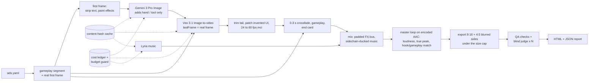

# creative-forge

Spec-driven pipeline for mobile game video ads with an AI-generated hook and real gameplay. A YAML spec goes in. Mastered 9:16 and 4:5 videos come out, each with a QA report that records what was measured and which threshold it was judged against.

```
forge plan  examples/ads.yaml          # cost estimate + spec lint, no calls
forge run   examples/ads.yaml --budget-usd 15
forge qa    out/puzzle-ads/*.mp4
forge demo                             # full pipeline offline: fake providers, synthetic gameplay
```

## Why it exists

I used these scripts in October 2026 to produce my studio's UA video ads for *Acorn Mart: Goods Sorting*, a puzzle game live on Google Play. The final round was 7 ads, 25–30 s each, delivered in 9:16 and 4:5, mastered to about −14 LUFS with true peak at or below −2.6 dBTP.

Every hook followed the same pattern. Gemini 3 Pro Image edits a real gameplay frame. Veo 3.1 then animates it image-to-video, with `lastFrame` set to the real first gameplay frame so the AI shot lands exactly on real gameplay. A 0.3 s crossfade leads into real gameplay of the same level, followed by an end card. The music was made with Lyria 3 Pro.

The scripts worked, but every QA round found another defect a quick watch had missed. Those were one-off, single-machine scripts. This repo turns them into a tool someone else can run. Each defect became a requirement: either the pipeline prevents it, or a check measures it, or both, and each has a test on synthetic media.

## Architecture



- **Providers sit behind interfaces** (`ImageEditProvider`, `VideoProvider`, `MusicProvider`, `JudgeProvider`). The Vertex AI implementations call REST directly through `google-auth` Application Default Credentials and `requests`. The `Fake*` implementations synthesize media with ffmpeg, so the whole pipeline runs without keys.
- **No paid call is repeated.** Every generation is keyed by a SHA-256 over the request, with each input file replaced by the hash of its bytes. A Veo operation name is saved the moment the job is accepted, so a rerun after a crash or timeout resumes polling that job instead of paying for a new one.
- **Budget guard.** `--budget-usd` reserves each call's list price *before* the call. A call that would cross the budget never starts. The ledger records every call, including cache hits and the amount they saved.
- **One temp directory per job** and one lock per cache key. Concepts render concurrently (`--jobs`).

See [docs/ARCHITECTURE.md](docs/ARCHITECTURE.md) for the module map, the timeline arithmetic and how the master loop works.

## Quickstart (no keys, no cost)

You need Python 3.11 or newer and ffmpeg 6 or newer with libx264.

```bash
python3 -m venv .venv && . .venv/bin/activate
pip install -e ".[dev]"
forge demo            # writes out/demo/: 2 concepts x 2 formats + report.html
pytest                # the full suite, including one end-to-end demo run
```

The demo builds synthetic "gameplay" from ffmpeg's `testsrc2` and runs it through every stage with fake providers. That includes real 24 → 60 fps motion interpolation, the loudness loop, both exports, OCR and a two-run blind judge. The report shows a $0 charge next to the list price the same calls would cost on Vertex AI.

## Real run (Vertex AI)

```bash
gcloud auth application-default login
export CREATIVE_FORGE_PROJECT=<your-project-id>   # never stored in the repo
# optional: CREATIVE_FORGE_VIDEO_LOCATION (default us-central1), CREATIVE_FORGE_GENAI_LOCATION (default global)

forge plan examples/ads.yaml                 # upper-bound cost, lint findings
forge run examples/ads.yaml --dry-run        # + input files, ffmpeg, project variable
forge run examples/ads.yaml --budget-usd 15
```

Model IDs live in the spec (`models:`), and prices live in [`creative_forge/data/pricing.yaml`](creative_forge/data/pricing.yaml) (`as_of: 2026-10`). Check both against Google Cloud before a paid run, and override prices with `--pricing pricing.local.yaml`. The judge has no recorded price, so under a budget it is refused until you add one.

## QA checks and the defects behind them

Each check returns `pass` / `warn` / `fail` / `skip` with the measured value and its threshold. A skip always states its reason. Thresholds are set in the spec's `qa:` and `audio:` sections.

| # | Production defect | Prevention in the pipeline | Check (default threshold) |
|---|---|---|---|
| 1 | The engine's audio track ended 1.6 s before the video, because the sidechain FX track was shorter | FX bus padded to the full length (`apad=whole_dur`) | `av_duration`: \|video − audio\| ≤ 0.1 s, fail > 0.5 s |
| 2 | ffmpeg's built-in `aac` encoder overshot true peak by +6.7 dB on limited signals | `aac_at` (AudioToolbox) preferred on macOS; true peak measured after encoding, limiter pulled down if needed | `true_peak` on the delivered file: ≤ −2.0 dBTP, fail > −1.0 |
| 3 | `-shortest` cut the video to the shorter audio | never used; every mux and encode has an explicit duration | `av_duration` + test |
| 4 | Parallel jobs sharing temp files corrupted outputs | private temp dir per job, per-call temp files, per-key generation lock | concurrency tests |
| 5 | Veo copies text from the first frame as garbled text ("MILK" → "MIILAK") | `hook.text_regions` blurred out of the first frame | `first_frame_text`, `hook_text`: OCR, near-miss of a known word = fail |
| 6 | Veo drifts in the last ~1 s (stylized mascot turns photoreal) and invents fake UI in the last ~3 s | tail trim (`cut_s`, default duration − 1 s), `hook.patches` cover invented UI with real pixels | lint `tail-drift` / `tail-ui`; `hook_landing` (Veo frame at the cut vs the real frame) |
| 7 | Hands or tools covering UI made Veo invent fake UI behind them | prompt rule: the hand enters from an edge | lint `hand-enters-from-edge` |
| 8 | Gemini redraws products when asked to add dust or mud to the whole frame | `hook.effects` painted on the real frame in code; Gemini only adds the hand/tool | lint `effects-programmatic` |
| 9 | Veo outputs 24 fps; plain `fps=60` duplicated frames and juddered | `minterpolate=mi_mode=mci` to 60 fps, then an exact 2:1 drop to 30 | `cadence`: isolated repeated frames ≤ 2 %, fail > 8 % |
| 10 | One ad opened on a frozen, silent first 0.5 s | (caught, then trimmed) | `intro_freeze` (`freezedetect`), `intro_silence` (`silencedetect`) |
| 11 | Hook vs gameplay loudness differed by +5 to −9 LU | loop measures *after* the limiter and corrects again; one pass is not enough because the limiter squashes gameplay SFX more | `hook_gameplay_loudness`: ≤ 0.8 LU, fail > 2 |
| 12 | The 4:5 variant must not crop gameplay | full 9:16 frame centred, blurred and darkened sides | `format` (exact size and aspect) + pixel test |
| 13 | Single-run LLM blind scores are noisy (same video scored 8, then 4) | judge runs N ≥ 2 times on shuffled, code-named videos | `judge`: mean and stdev per criterion; warn if a criterion's stdev > 1 or only one run |
| 14 | Files must stay under 30 MB | crf 20 + maxrate 3.6M (lowered automatically for longer ads) | `file_size`: ≤ 30 MB |

The suite also checks `duration` (spec window), `loudness` (−14.3 LUFS ± 1 LU) and `seam` (last hook frame vs first clean gameplay frame, mean absolute difference on a 0–255 scale).

## Lessons learned

- **Keep the AI where mistakes are cheap.** The hook is generated. Everything after the cut is the real game, and `lastFrame` makes the generated shot end on those exact pixels.
- **Ask the image model for the smallest possible edit.** Add the hand and tool with the model. Paint the dust or mud in code.
- **Measure what ships.** Loudness and true peak are measured on the encoded file, after the limiter. Seam, cadence and OCR are measured on the delivered video.
- **An LLM judge is a noisy sensor.** Blind it, run it more than once, and report the variance with the mean.
- **Treat paid calls like money.** Each one gets a cache key, a ledger entry, a budget check before it starts, and a saved operation name before any polling.

## Limitations

- Built around one studio's goods-sort puzzle ads. The defaults (end card, layout, judge rubric) reflect that.
- There is no ad-performance data yet. QA measures technical correctness and an LLM's opinion, not CPI or IPM.
- OCR works best on macOS (Vision, compiled on first use with `swiftc`). The tesseract fallback is weaker on stylized game fonts. With neither installed, the OCR checks report `skip`.
- The real providers are tested only against mocked HTTP in this repo. The Lyria provider follows Vertex AI's documented `:predict` request shape. The October 2026 tracks were made through a different endpoint whose script was not kept, so verify that request shape before a paid run.
- Seam, landing and cadence thresholds are heuristic defaults, not values tuned on a large set.
- The original engine also had a game-specific motion-graphics layer: camera keyframes, a pointer synced to logged taps, text cards. That layer is not ported. This repo covers generation, assembly, sound, export and QA.
- Developed and tested on macOS. `.github/workflows/ci.yml` runs lint and tests on Ubuntu with the distro's ffmpeg. Windows is untested.

## Layout

```
creative_forge/
  spec.py, pricing.py, ledger.py, cache.py, retry.py, config.py
  providers/   base.py (interfaces), vertex.py (REST), fake.py (ffmpeg)
  stages/      video.py (gameplay, hook, end card, assembly), audio.py (mix, master, mux), export.py
  qa/          media_checks.py, audio_checks.py, seam.py, ocr.py (+ ocr_vision.swift), judge.py, runner.py
  pipeline.py, report.py, lint.py, demo.py, cli.py
examples/ads.yaml   tests/   docs/ARCHITECTURE.md
```

MIT licensed.
